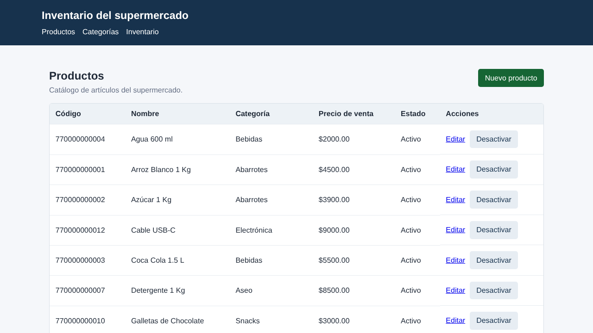
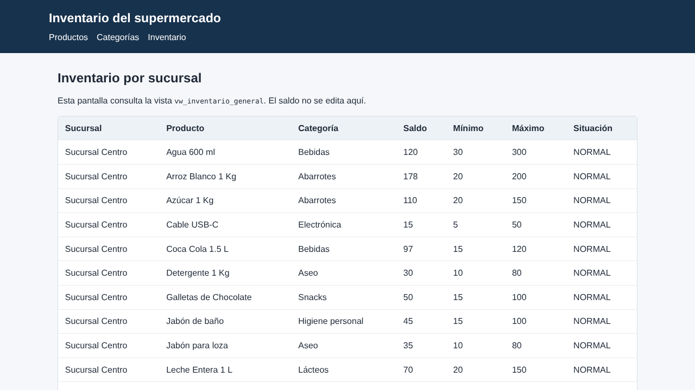

<div align="center">


<br>


**Prototipo web local para administrar el inventario de un supermercado con varias sucursales.**

</div>

---

## Integrantes

| | | |
|:--:|:--:|:--:|
| **Cristian Echavarria** | **José Manuel Rengifo** | **Cristian Osorio** |

## Estado

| Módulo | Estado |
| --- | --- |
| Modelo de datos, vistas y consultas | ✅ Creado |
| CRUD de categorías y productos | ✅ Funcionando |
| Consulta de inventario por sucursal | ✅ Solo lectura |
| Autenticación y permisos por rol | ✅ Inicio de sesión y administración de usuarios |
| Compras y ventas | 🚧 Pendiente |
| Movimientos de kardex y alertas | 🚧 Pendiente |

## Capturas

| Catálogo de productos | Inventario por sucursal |
| :---: | :---: |
|  |  |

## Inicio rápido

Instala las dependencias, inicia **MySQL** en XAMPP y configura la contraseña de la cuenta administradora siguiendo la [guía de inicio rápido](GUIA_INICIO_RAPIDO.md). Luego ejecuta:

```powershell
.\.venv\Scripts\python.exe main.py
```

La aplicación queda en **http://127.0.0.1:5000**. Los pasos completos están en la [guía de inicio rápido](GUIA_INICIO_RAPIDO.md).

## Estructura

| Pieza | Responsabilidad |
| --- | --- |
| `main.py` | Punto de entrada, como en `19102026`. |
| `app.py` | Rutas web de Flask, autenticación, autorización y protección CSRF. |
| `Aplicaciones/` | Casos de uso y reglas de usuarios, categorías, productos e inventario. |
| `Entidades/` | Clases de categoría, producto y existencia. |
| `Repositorios/` | Consultas SQL, escritura y transacciones con PyMySQL. |
| `Utilidades/` | Configuración de Flask y MySQL desde `.env`. |
| `Script.sql` | Instalación de una base de demostración independiente. |
| `BD/procedimientos_almacenados.sql` | Rutinas de alta de productos, movimientos de inventario y consulta de kardex. |
| `templates/`, `static/` y `assets/` | Interfaz web, estilos y recursos. |
| `BD/` y `docs/` | Modelo original, consultas, diagramas y documentación. |

La referencia usa un programa de consola y una conexión ODBC. Esta versión toma su organización por capas y conserva Flask y PyMySQL para ejecutar las funciones web existentes.


## Documentación

| Documento | Contenido |
| --- | --- |
| [Guía de inicio rápido](GUIA_INICIO_RAPIDO.md) | Ejecución en Windows y orden de lectura del código |
| [Especificación funcional](docs/especificacion_funcional.md) | Requisitos, roles y flujos |
| [Arquitectura y datos](docs/arquitectura_y_datos.md) | Diseño y revisión del modelo |
| [Diagramas](docs/diseno_capas_componentes.drawio) | Diseño anterior y entidad relación, en draw.io |

## Notas

> [!WARNING]
> `BD/Base_Datos.sql` empieza con `DROP DATABASE`. No lo ejecutes sobre una base con información que quieras conservar.

> [!NOTE]
> **Eliminar significa desactivar** (`estado = 0`), para conservar las referencias históricas. Un producto con existencias no se puede desactivar.

## Referencias

- [Flask: estructura de una aplicación](https://flask.palletsprojects.com/en/stable/tutorial/factory/)
- [PyMySQL: conexión y consultas](https://pymysql.readthedocs.io/en/latest/user/examples.html)
- [Apache Friends: preguntas frecuentes de XAMPP en Windows](https://www.apachefriends.org/faq_windows)
