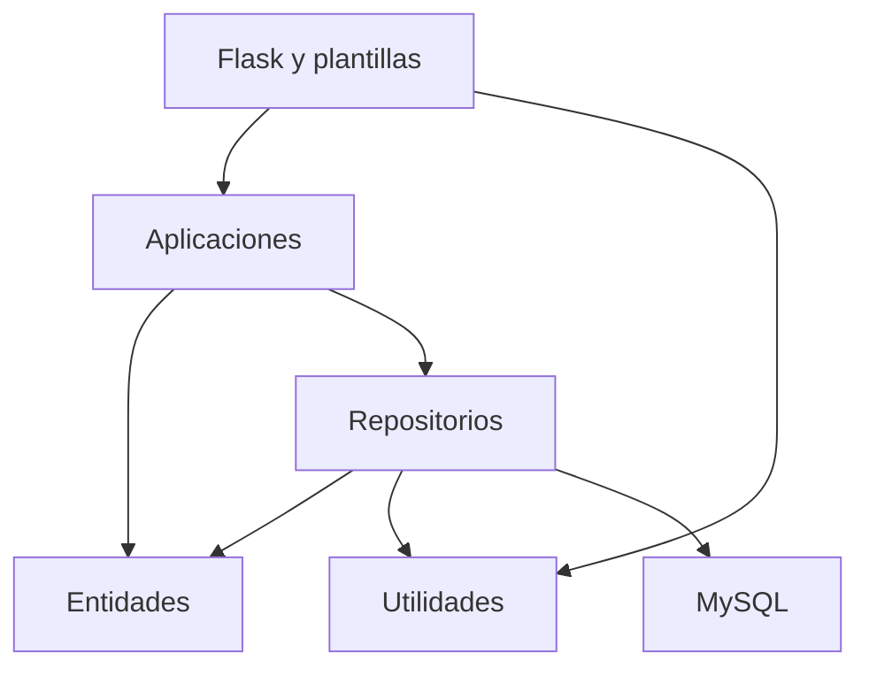

# Arquitectura y revisión del modelo de datos

## 1. Arquitectura actual

El proyecto adapta la organización de `19102026` al CRUD web de inventario.



`main.py` inicia Flask en `127.0.0.1:5000`. `app.py` recibe las peticiones y delega las operaciones a `Aplicaciones/`. Los repositorios ejecutan las consultas con PyMySQL y cargan los datos en entidades. `Utilidades/Configuracion.py` lee el archivo `.env` para configurar Flask y MySQL. XAMPP proporciona el módulo MySQL y, mediante Apache, permite acceder a phpMyAdmin.

Las altas de producto y de existencias iniciales se guardan en una sola transacción. La pantalla de inventario consulta la vista `vw_inventario_general`. El archivo `Script.sql` crea una base independiente con los datos del DDL histórico. Los diagramas originales de `diseno_capas_componentes.drawio` conservan el diseño anterior y el modelo entidad-relación.


## 2. Revisión del DDL existente

El archivo `BD/Base_Datos.sql` crea 16 tablas, 4 vistas, datos iniciales y 20 consultas de prueba. Tiene claves foráneas, unicidad de inventario por producto y sucursal y restricciones básicas. El CRUD inicial usa el esquema existente; antes de ampliar operaciones y seguridad se necesitan los siguientes ajustes.

| Prioridad | Hallazgo | Ajuste propuesto |
| --- | --- | --- |
| Alta | El script inicia con `DROP DATABASE IF EXISTS`. | El archivo histórico se conserva en BD/. Para una instalación nueva, usa `Script.sql` y su base independiente. |
| Alta | `usuarios.password` y usuarios de prueba guardan `123456` en texto plano. | Cambiar a `password_hash VARCHAR(255)`, retirar contraseñas literales del SQL y crear el primer administrador con un comando Python que genere un hash. No basta con renombrar la columna: los datos actuales seguirían siendo texto plano. |
| Alta | Compra `FC-10001`: encabezado subtotal `320000`, detalles `100×3200 + 50×2800 = 460000`. | Con la tasa de ejemplo del 19 %, corregir a subtotal `460000`, impuesto `87400` y total `547400`; después verificar todas las facturas automáticamente. |
| Alta | El stock se ajusta con `UPDATE` manual y solo cinco movimientos de prueba. | Cargar saldos iniciales y operaciones de prueba de forma coherente con kardex; en la aplicación, actualizar stock y registrar movimiento en una misma transacción. |
| Media | `compras.numero_factura` no es único. | Añadir `UNIQUE (id_proveedor, numero_factura)` para impedir duplicados de un proveedor. |
| Media | Un descuento puede superar el bruto de una línea y producir subtotal negativo. | Añadir `CHECK (descuento <= cantidad * precio_unitario)` a ambos detalles. |
| Media | La vista y el alta de alertas usan `< stock_minimo`. | Usar `<= stock_minimo`, manteniendo primero la condición de agotado. |
| Media | Los impuestos están solo en encabezados; falta la regla para tasas distintas por producto. | Guardar tasa predeterminada en producto y tasa aplicada en cada línea. Calcular el total en Python según la especificación funcional y validarlo con los detalles. La venta `FV-10002` también deberá corregirse: subtotal `16000`, descuento informativo `500`, impuesto `3040` y total `19040` con la tasa de ejemplo del 19 %. |
| Media | `alertas_inventario` solo se llena durante la carga inicial. | Crear/actualizar alertas al cambiar existencias y cerrar las que dejan de corresponder; evitar duplicados pendientes. |
| Baja | Stock mínimo y máximo existen en `productos` y en `inventario`. | Mantener los valores del producto como **predeterminados**; el registro de cada sucursal guarda sus límites efectivos. Documentar y mostrar esta diferencia en la interfaz. |

El archivo de exclusiones original se llama `gitignore`, sin punto. Ya se creó una copia funcional `.gitignore` para excluir `.env`, entornos virtuales y temporales; se conservó el archivo original.

## 3. Cambios de esquema sugeridos

Estos fragmentos describen el destino del DDL, **no son una migración lista para ejecutar** sobre una base existente. La instalación de demostración en `Script.sql` conserva el modelo original. Los cambios siguientes se aplicarán cuando se acuerden impuestos y datos de prueba.

```sql
-- En la tabla usuarios de la nueva versión:
password_hash VARCHAR(255) NOT NULL

-- En compras:
CONSTRAINT uq_compras_proveedor_factura
    UNIQUE (id_proveedor, numero_factura)

-- En detalle_compras (repetir en detalle_ventas con nombre propio):
CONSTRAINT chk_detalle_compras_descuento_bruto
    CHECK (descuento <= cantidad * precio_unitario)

-- En productos, como valor predeterminado al crear operaciones:
tasa_impuesto DECIMAL(5,2) NOT NULL DEFAULT 0,
CONSTRAINT chk_productos_tasa_impuesto
    CHECK (tasa_impuesto BETWEEN 0 AND 100)

-- En detalle_compras (repetir en detalle_ventas con nombre propio):
tasa_impuesto_aplicada DECIMAL(5,2) NOT NULL DEFAULT 0,
CONSTRAINT chk_detalle_compras_tasa_impuesto
    CHECK (tasa_impuesto_aplicada BETWEEN 0 AND 100)
```

Para impuestos se propone agregar `tasa_impuesto` al catálogo como valor predeterminado y `tasa_impuesto_aplicada` al detalle de cada compra o venta para conservar la tasa histórica. La fórmula y el redondeo se describen en la especificación funcional. Los datos de ejemplo usarán el 19 % solo como escenario académico y no se presentarán como liquidación fiscal real.

No se propone un disparador que cambie el inventario: la operación de negocio debe guardar encabezado, detalles, movimiento y saldo en **una transacción**. Para evitar ventas simultáneas con el mismo saldo, el servicio bloqueará la fila de inventario dentro de la transacción (`SELECT ... FOR UPDATE`) y validará el stock antes de descontar. Si algo falla, toda la operación se revierte.

## 4. Decisiones técnicas y verificación

- Autenticación por sesión; contraseñas con hash mediante Werkzeug, sin claves en el repositorio.
- Validación en servidor para todos los formularios y protección CSRF en operaciones que cambian datos.
- Uso de `Decimal` para dinero y de claves foráneas para conservar relaciones.
- `estado` para desactivar catálogos sin borrar historial; no borrar compras, ventas ni movimientos desde la interfaz.
- Pruebas de permisos, integridad de saldos, operaciones repetidas, concurrencia básica y conciliación de importes.
- Primero ejecutar la versión revisada del esquema en una base de **pruebas nueva** de MySQL; comprobar tablas, vistas, restricciones y consultas antes de utilizarla para desarrollo.

## 5. Fuentes técnicas

- [Flask: fábrica de aplicación y organización](https://flask.palletsprojects.com/en/stable/tutorial/factory/)
- [Flask: módulos mediante blueprints](https://flask.palletsprojects.com/en/stable/blueprints/)
- [PyMySQL: conexión y consultas parametrizadas](https://pymysql.readthedocs.io/en/latest/user/examples.html)
- [MySQL: bloqueo `FOR UPDATE`](https://dev.mysql.com/doc/refman/8.0/en/innodb-locking-reads.html)
- [Werkzeug: hash de contraseñas](https://werkzeug.palletsprojects.com/en/stable/utils/)
- [Apache Friends: preguntas frecuentes de XAMPP en Windows](https://www.apachefriends.org/faq_windows)
